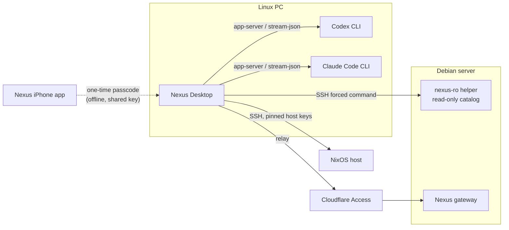

<div align="center">


# Nexus Desktop

**An AI IDE and home-lab control room for Linux and NixOS, in Rust.**<br>
The Linux edition of Nexus Desktop, companion to the Nexus iPhone app, in the Midnight Liquid Glass design.

[](flake.nix)
[](rust-toolchain.toml)
[](crates/nexus-ui)
[](#ai-providers)
[](#license)

[**Install**](#install) ·
[Configure](#configure) ·
[Linux parity](docs/PARITY-LINUX.md) ·
[Status](docs/STATUS.md) ·
[Security model](docs/SECURITY-MODEL.md) ·
[iPhone parity](docs/PARITY.md) ·
[Build &amp; release](docs/BUILD-AND-RELEASE.md)

</div>

---

## What it does

<table>
<tr>
<td width="50%" valign="top">

### IDE
Workspace explorer that honours `.gitignore`, `.cursorignore` and `.nexusignore`.
Multi-tab editor with syntax highlighting for 15+ languages, multi-cursor,
find/replace, minimap, split view and a Git gutter. Quick open, command palette,
workspace search, source control, build/test tasks with a Problems list, and
terminals for your login shell, Bash, Zsh, Fish and PowerShell.

</td>
<td width="50%" valign="top">

### AI
**Codex** (official `codex app-server`) and **Claude Code** (official CLI) in
Ask, Plan, Agent and Bypass modes, plus OpenAI-compatible APIs and PS5LM Plus.
Visible context sharing, secret detection, image and PDF attachments,
command approvals, agent edits reviewed hunk by hunk, Ctrl+K inline edits and
resumable sessions with task memory.

</td>
</tr>
<tr>
<td width="50%" valign="top">

### Infrastructure
Dashboard with live telemetry and low-resource alerts, devices with pinned SSH
host keys, services, logs, processes and network probes. SSH and SFTP terminals
for hosts you allow, NixOS dry-build and switch, Debian shadow workspaces,
Minecraft and PS5LM status.

</td>
<td width="50%" valign="top">

### Security
Every remote action goes through one policy engine in Rust. A host marked as the
protected Debian server is read-only by default, enforced on the server by the
`nexus-ro` helper. Its owner can unlock writes for 30 minutes; AI agents never can.
Optional app lock with a 4-digit code from the iPhone app.

</td>
</tr>
</table>

## How the pieces fit



## Install

Needs Nix with flakes on x86_64 or aarch64 Linux. NixOS is the main target.

Try it without installing:

```bash
nix run github:ljcatherine/NexusNix
```

Install it on NixOS by adding the flake to your system configuration:

```nix
# flake.nix
inputs.nexus-nix.url = "github:ljcatherine/NexusNix";

# in a NixOS module
imports = [ inputs.nexus-nix.nixosModules.default ];
programs.nexus-desktop.enable = true;   # app, desktop entry, sign-in URL handler, XDG portal
```

The package is marked unfree (see [License](#license)). The flake's own outputs
and the NixOS module allow it. If you use `overlays.default` with your own nixpkgs,
allow it there, for example with
`nixpkgs.config.allowUnfreePredicate = p: lib.getName p == "nexus-desktop";`.

From a checkout:

```bash
nix build        # ./result/bin/nexus-desktop
nix run
nix develop      # Rust toolchain, OpenSSH, git and the runtime libraries
```

Nexus needs a Secret Service provider (KWallet on Plasma, or GNOME Keyring)
for API keys, SSH passphrases and the app-lock secret, and an XDG desktop portal
for file dialogs. It runs through XWayland by default so the app lock can see
minimising; `NEXUS_WAYLAND=1` selects native Wayland (see
[PARITY-LINUX](docs/PARITY-LINUX.md), P24).

## Configure

Everything specific to your own setup lives outside the source. Without it, Nexus
still runs as an IDE and AI client and can manage hosts you add over LAN or
Tailscale; only the Cloudflare relay and Access sign-in stay off.

Copy [`docs/site.example.json`](docs/site.example.json) to
`~/.config/nexus-desktop/site.json` and fill in your values:

| Field | What it is |
|---|---|
| `gateway_host` | Host name of your Nexus Worker (Cloudflare relay and Access resource) |
| `access_issuer` | Your Cloudflare Access team URL, `https://<team>.cloudflareaccess.com` |
| `access_client_id` | The Access application's public native client id |
| `debian_user` | SSH account on the server Nexus must treat as read-only |
| `nixos_user` | SSH account on your NixOS machine |

On NixOS you can set the same values with `programs.nexus-desktop.site = { … };`,
which writes `/etc/nexus-desktop/site.json`. A per-user file takes precedence.

## AI providers

| Provider | Setup | Billing |
|---|---|---|
| **OpenAI Codex** | Install the Codex CLI, run `codex login` | Your ChatGPT plan |
| **Claude Code** | Install Claude Code, run `claude auth login` (or Settings → AI providers → *Sign in…*) | Your Claude Pro/Max plan |
| **OpenAI-compatible** | Settings → AI providers → add an endpoint; keys go to the Secret Service (KWallet / GNOME Keyring) | The API's own billing |
| **PS5LM Plus** | Settings → AI providers → set its LAN URL | Local |

A provider only shows **Connected** after its sign-in and a real test turn both succeed.

## Build from source

> [!NOTE]
> Needs Nix with flakes. Outside Nix: Rust 1.95+, a C compiler, OpenSSH, git, and
> at run time libxkbcommon, Vulkan or libGL, Wayland and X11 libraries.

```bash
nix develop
cargo build --release -p nexus-app      # target/release/NexusDesktop
cargo test --workspace
cargo run -p nexus-app                  # debug run
```

`nix build` runs the whole workspace test suite inside the sandbox before
packaging. Builds are local; no CI.

The app icon is drawn as SVG in [`crates/nexus-app/assets/brand`](crates/nexus-app/assets/brand) and
rendered to `.png` by [`scripts/render-icons.sh`](scripts/render-icons.sh).

## Security

> [!IMPORTANT]
> The protected Debian server (it can host the Nexus gateway) is read-only by
> default. That rule is enforced in the Rust backend
> ([`nexus-security`](crates/nexus-security)) and on the server
> ([`nexus-ro`](crates/nexus-ro)), not only in the UI. AI agents never get write
> access to it in any mode. Nexus never disables SSH host-key or TLS checks.

The full model, including the owner's timed unlock and the app lock, is in
[docs/SECURITY-MODEL.md](docs/SECURITY-MODEL.md) and [docs/OTP.md](docs/OTP.md).

Found a security problem? Please open a private
[security advisory](https://github.com/ljcatherine/NexusNix/security/advisories/new)
instead of a public issue.

## Project layout

<details>
<summary><b>Crates</b></summary>

| Crate | What it holds |
|---|---|
| [`nexus-app`](crates/nexus-app) | The application |
| [`nexus-ui`](crates/nexus-ui) | Midnight Liquid Glass design system |
| [`nexus-ide`](crates/nexus-ide) | Editor engine and widget |
| [`nexus-terminal`](crates/nexus-terminal) | Unix PTY terminals on `alacritty_terminal` |
| [`nexus-providers`](crates/nexus-providers) | Codex, Claude Code and OpenAI-compatible adapters |
| [`nexus-agents`](crates/nexus-agents) | Sessions (SQLite), snapshots, task memory |
| [`nexus-context`](crates/nexus-context) | Context sharing rules, secret scan, project instructions |
| [`nexus-workspaces`](crates/nexus-workspaces) | Workspaces, search, shadow workspaces, change sets |
| [`nexus-git`](crates/nexus-git) | Guarded Git CLI wrapper |
| [`nexus-security`](crates/nexus-security) | Policy engine, Debian rules, command catalog, audit, host keys, app-lock passcode |
| [`nexus-ro`](crates/nexus-ro) | SSH forced-command helper that enforces the read-only catalog on the server |
| [`nexus-ssh`](crates/nexus-ssh) | Grant-gated SSH and read-only SFTP |
| [`nexus-access`](crates/nexus-access) | Cloudflare Access sign-in for the gateway relay |
| [`nexus-telemetry`](crates/nexus-telemetry) | Metrics parser and history (ported from iOS) |
| [`nexus-core`](crates/nexus-core) | Device model (iOS-compatible JSON), Linux platform integration (XDG paths, xdg-open, file manager, terminal emulator) |

</details>

<details>
<summary><b>Docs</b></summary>

| Doc | About |
|---|---|
| [STATUS](docs/STATUS.md) | What works, what is verified, newest first |
| [PARITY-LINUX](docs/PARITY-LINUX.md) | Every Windows feature mapped to its Linux implementation and test, with the gaps |
| [PARITY](docs/PARITY.md) | Feature-by-feature comparison with the iPhone app |
| [SECURITY-MODEL](docs/SECURITY-MODEL.md) | Threat model and enforcement |
| [OTP](docs/OTP.md) | App-lock passcode spec shared with iOS |
| [PLAN](docs/PLAN.md) · [adr/](docs/adr) | Design decisions |
| [BUILD-AND-RELEASE](docs/BUILD-AND-RELEASE.md) | Toolchain, commands and data locations |
| [log/](docs/log) | Dated development log |

</details>

## License

Copyright © 2026 Liam Catherine. All rights reserved.

The source is published so you can read, build and run it, but no open-source
license is granted: the workspace is `LicenseRef-Proprietary`, and Nix marks the
package unfree. Ask before redistributing or reusing the code.

<div align="center">
<sub>Nexus Desktop for Linux · built locally with Nix</sub>
</div>
